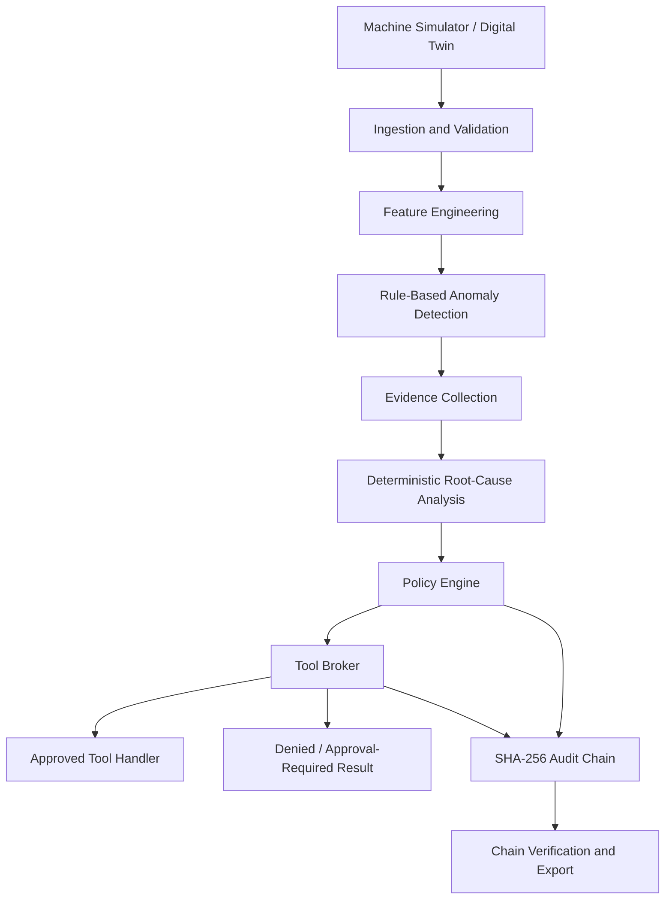

# 🏭 FactoryMind

### Industrial AI for Machine Health, Root-Cause Analysis, Governed Actions, and Auditable Operations

[](https://www.python.org/) [](#-testing-and-quality) [](#-system-architecture) [](LICENSE)

**FactoryMind is an industrial AI engineering platform that simulates machine telemetry, detects abnormal behavior, explains likely failure causes, evaluates operational policies, and routes permitted actions through a controlled tool broker with a tamper-evident audit trail.**

Its central principle is simple: **detecting a problem does not automatically authorize an action.** FactoryMind keeps detection, diagnosis, authorization, execution, and audit as separate, testable stages.

> **Project scope:** FactoryMind currently uses synthetic telemetry and a digital-twin-style simulator. It is a portfolio/reference implementation—not a live factory integration or a certified industrial safety system.

---

## 📚 Table of Contents

- [🎯 Why FactoryMind?](#-why-factorymind)
- [⚙️ What It Does](#️-what-it-does)
- [✨ Key Features](#-key-features)
- [🏗️ System Architecture](#️-system-architecture)
- [🔄 End-to-End Workflow](#-end-to-end-workflow)
- [🧪 Example Outputs](#-example-outputs)
- [🧰 Technology Stack](#-technology-stack)
- [📁 Repository Structure](#-repository-structure)
- [🚀 Quick Start](#-quick-start)
- [⚙️ Configuration](#️-configuration)
- [🧪 Testing and Quality](#-testing-and-quality)
- [🏭 Industrial Use Cases](#-industrial-use-cases)
- [🔐 Safety, Security, and Reliability](#-safety-security-and-reliability)
- [⚠️ Current Limitations](#️-current-limitations)
- [🗺️ Roadmap](#️-roadmap)
- [📄 License](#-license)

## 🎯 Why FactoryMind?

Industrial machines produce many signals—temperature, vibration, pressure, motor current, speed, load, coolant flow, and acoustic level. A single unusual reading can indicate a real fault, a transient spike, sensor drift, or a failed sensor. Reliable monitoring therefore needs more than a threshold alarm.

FactoryMind demonstrates a traceable workflow that can:

1. Simulate machine telemetry and failure progression.
2. Validate readings and identify missing, implausible, or contradictory values.
3. Calculate rolling statistics, temporal trends, and sensor-correlation features.
4. Detect anomalies using configurable rules and trend confirmation.
5. Compare evidence with known failure signatures to produce an explainable root-cause result.
6. Check whether a proposed action is allowed or requires human approval.
7. Execute actions only through a policy-enforcing tool broker.
8. Record decisions and outcomes in a SHA-256 hash-chained audit log.

The emphasis is on **transparent, repeatable decisions** rather than hiding operational behavior inside an opaque agent loop.

## ⚙️ What It Does

| Stage | Purpose | Result |
|---|---|---|
| Digital-twin-style simulator | Generates sensor readings and simulated faults | Time-stamped telemetry |
| Ingestion and validation | Checks presence and plausibility of readings | Validated snapshots and validation events |
| Feature engineering | Examines recent history, trends, and sensor relationships | Feature vectors and trend indicators |
| Anomaly detection | Identifies threshold breaches and suspicious patterns | Structured anomaly records |
| Root-cause analysis (RCA) | Compares evidence with known failure signatures | Ranked candidate and supporting evidence |
| Policy engine | Determines whether an action is allowed, denied, or needs approval | Policy decision |
| Tool broker | Validates and gates tool execution | Execution result or denial |
| Audit chain | Links decisions and events with cryptographic hashes | Verifiable event history |

## ✨ Key Features

### 1. 🏭 Machine Simulation and Fault Injection

The simulator models **nine sensor channels**:

- Temperature
- Vibration
- Pressure
- Motor current
- RPM
- Load
- Coolant temperature
- Coolant flow
- Acoustic level

It supports **seven failure modes**:

- Bearing degradation
- Bearing failure
- Thermal overload
- Cooling failure
- Mechanical imbalance
- Motor overload
- Sensor fault

The project includes **11 predefined scenarios**, covering cases such as healthy operation, gradual degradation, sudden failure, sensor dropout, sensor drift, and stuck readings. Noise and sensor-quality problems can be simulated to exercise the pipeline under imperfect data.

**Why it matters:** Synthetic scenarios make rare faults repeatable and safer to test. They do not replace evaluation on real, labelled industrial telemetry.

### 2. 📥 Data Validation and Feature Engineering

The ingestion layer checks expected sensor channels, plausible ranges, missing/NaN readings, and basic inconsistencies. The feature layer calculates:

- Rolling mean, standard deviation, minimum, and maximum
- Exponentially weighted moving average (EWMA)
- Lag features
- Least-squares trend slopes
- Sensor-pair correlation deviations

For example, rising vibration alongside rising temperature may support a bearing-degradation hypothesis. An isolated vibration spike while related channels remain normal may instead support a sensor-fault hypothesis. These are **evidence patterns, not guaranteed diagnoses**.

### 3. 🚨 Explainable Anomaly Detection

The rule-based detector compares readings with configurable warning and critical thresholds. Trend confirmation helps distinguish persistent changes from isolated spikes.

Documented anomaly categories include:

- `THRESHOLD_BREACH`
- `TREND_ANOMALY`
- `CORRELATION_ANOMALY`
- `CONTRADICTION`

Instead of emitting only a text alert, the detector produces structured records that downstream components can inspect and test.

### 4. 🔎 Deterministic Root-Cause Analysis

The RCA engine compares observed evidence with predefined failure signatures. A signature describes primary and secondary sensors, expected trends, and relevant correlation pairs.

Documented scoring weights:

| Evidence | Score adjustment |
|---|---:|
| Primary sensor match | `+0.30` |
| Secondary sensor match | `+0.15` |
| Trend match | `+0.10` |
| Contradiction penalty | `-0.20` |

The engine ranks candidate causes according to its implemented rules. Contradictory readings can help distinguish a sensor fault from a machine fault.

> **Score interpretation:** These are heuristic scores, not calibrated probabilities. A score of `0.65` must not be interpreted as a 65% probability of failure.

### 5. 🛡️ Policy-as-Code and Human Approval

The policy engine evaluates requests using **eight ordered rules**. The documented behavior includes:

- Blocking actions when a machine is shut down or under maintenance
- Automatically approving read-only tools
- Allowing inspection scheduling only when the configured degradation condition is met
- Requiring operator approval for load reduction at a higher degradation level
- Requiring supervisor approval for shutdown under severe/critical risk conditions
- Denying by default when no rule grants permission

Policy decisions are represented as:

- `ALLOW`
- `DENY`
- `REQUIRE_APPROVAL`

This separation is essential: an anomaly or AI recommendation does not grant permission to operate machinery.

### 6. 🔧 Controlled Tool Execution

The tool broker is the single path for tool execution. It:

1. Confirms the requested tool exists.
2. Validates input against the tool schema.
3. Evaluates the policy.
4. Checks any required approval.
5. Executes the handler only when permitted.
6. Records the result in the audit chain.

The six documented tools are:

- `get_machine_status`
- `get_sensor_history`
- `schedule_inspection`
- `reduce_machine_load`
- `shutdown_machine`
- `request_human_approval`

Read-only tools are designed for automatic approval; operational actions are subject to policy and approval requirements. If a required check fails, execution is denied.

### 7. 🧾 Tamper-Evident Audit Chain

Audit events can record the event type, timestamp, actor, tool, input/output, policy decision, previous hash, and event hash. Each event hash incorporates the previous event hash, linking events into a chain.

A verification routine checks the links and can detect changes that break chain integrity. However, a hash chain is **tamper-evident, not inherently tamper-proof**: an administrator with sufficient access could potentially rewrite the entire chain. Production systems should add access controls, independent backups, and separately controlled audit storage.

## 🏗️ System Architecture



### Design Principles

- **Deterministic reasoning:** The documented RCA path uses fixed rules and weights; an LLM is not in the core reasoning loop.
- **Policy enforcement:** Operational tools pass through the broker.
- **Default deny:** A suggestion alone never authorizes an action.
- **Immutable domain models:** Frozen dataclasses help reduce accidental mutation.
- **Configuration as code:** Sensor ranges, thresholds, and policy settings are externalized in YAML.
- **Separation of concerns:** Simulation, features, detection, RCA, policy, tools, and audit have distinct responsibilities.

## 🔄 End-to-End Workflow

Imagine a simulated machine whose vibration and temperature are steadily increasing:

1. **Collect:** The simulator produces a time-stamped snapshot containing nine sensor readings.
2. **Validate:** The ingestion pipeline checks the snapshot and adds it to the rolling history.
3. **Extract features:** Recent averages, trends, and sensor relationships are calculated.
4. **Detect:** The detector identifies threshold or trend anomalies.
5. **Explain:** RCA compares the evidence against known failure signatures.
6. **Authorize:** The policy engine evaluates any proposed action against machine state, risk, permissions, and thresholds.
7. **Act safely:** The tool broker denies, requests approval, or executes the permitted handler.
8. **Record:** The audit chain stores the decision and outcome.

The key distinction is between **evidence → diagnosis → authorization → execution**. Keeping these stages separate makes the system easier to debug, test, and review.

## 🧪 Example Outputs

> The JSON examples below are **illustrative**. They show the intended shape of results, not captured output from a real machine. Confirm exact fields against the current implementation before using them as API contracts.

### Example 1 — Telemetry Snapshot

```json
{
  "machine_id": "machine-0042",
  "timestamp": "2026-10-20T08:30:00Z",
  "sensors": {
    "temperature": 84.2,
    "vibration": 7.8,
    "pressure": 5.1,
    "motor_current": 18.6,
    "rpm": 1450,
    "load": 0.78,
    "coolant_temperature": 42.0,
    "coolant_flow": 12.5,
    "acoustic_level": 76.0
  }
}
```

**How to read it:** This snapshot captures the simulated machine at one point in time. Whether a reading is abnormal depends on configuration, recent history, trends, and machine context.

### Example 2 — Anomaly and Root-Cause Explanation

```json
{
  "anomalies": [
    {
      "sensor": "vibration",
      "type": "THRESHOLD_BREACH",
      "severity": "warning",
      "trend": "increasing"
    },
    {
      "sensor": "temperature",
      "type": "TREND_ANOMALY",
      "severity": "warning",
      "trend": "increasing"
    }
  ],
  "root_cause": {
    "candidate": "BEARING_DEGRADATION",
    "confidence_score": 0.65,
    "supporting_evidence": [
      "primary sensor vibration is abnormal",
      "secondary sensor temperature is abnormal",
      "both signals show an increasing trend"
    ]
  }
}
```

**How to read it:** The result names a candidate failure and the evidence supporting it. The score is heuristic—not a calibrated probability.

### Example 3 — Policy Decision

```json
{
  "requested_tool": "reduce_machine_load",
  "decision": "REQUIRE_APPROVAL",
  "reason": "Load reduction requires operator approval and the configured degradation condition must be met",
  "execution_status": "NOT_EXECUTED"
}
```

**How to read it:** The action remains unexecuted until the required approval is present. A request is not the same as a completed action.

### Example 4 — Audit Event

```json
{
  "event_type": "TOOL_EXECUTION_DENIED",
  "actor": "factorymind-policy",
  "tool": "reduce_machine_load",
  "policy_decision": "REQUIRE_APPROVAL",
  "previous_hash": "<previous-event-sha256>",
  "event_hash": "<sha256-of-this-event-and-chain-link>"
}
```

**How to read it:** The event links to the previous record. The placeholders are explanatory; the implementation calculates the actual hashes.

## 🧰 Technology Stack

| Technology | Role | Benefit |
|---|---|---|
| Python `>=3.11` | Core application and domain logic | Mature ecosystem for data and automation |
| NumPy | Numeric operations and simulated noise | Efficient numerical processing |
| Pandas | Dataset generation and tabular telemetry | Convenient dataframe workflows |
| SciPy | Statistical utilities | Signal/statistical analysis support |
| scikit-learn | Feature/ML extension points | Potential future learned anomaly models |
| Pydantic / dataclasses | Validated and immutable domain records | Explicit contracts and easier testing |
| PyYAML | Configuration loading | Keeps thresholds and settings out of code |
| pytest / pytest-cov | Unit and integration tests | Regression protection and coverage reporting |
| Ruff | Linting and formatting | Consistent Python style |
| mypy | Static type checking | Helps catch type errors before runtime |
| PyTorch (optional) | Learned-model extension point | Optional ML experimentation |
| FastAPI (optional) | API extension point | Potential integration boundary |
| FAISS (optional) | Vector-search extension point | Optional retrieval use cases |
| MLflow (optional) | Experiment tracking | Tracks experiments if ML components are added |

The core diagnostic and policy workflow does not require an LLM. Optional packages should only be installed when their associated features are implemented and used.

## 📁 Repository Structure

```text
.
├── pyproject.toml             # Package metadata and dependencies
├── Makefile.py                # Development command definitions (verify in repo)
├── SETUP_GUIDE.md             # Local setup guide
├── PROJECT_STRUCTURE.md       # Detailed architecture notes
├── configs/
│   └── default.yaml           # Sensor ranges, thresholds, policies, simulation settings
├── scripts/
│   └── generate_dataset       # Generate a synthetic CSV dataset
├── factorymind/
│   ├── domain/
│   │   ├── enums.py           # Machine, health, risk, event, and tool states
│   │   └── models.py          # Domain data models
│   ├── simulation/
│   │   ├── sensors.py         # Sensor generators and quality effects
│   │   ├── failures.py        # Failure-mode patterns
│   │   ├── machine.py         # Machine simulator and degradation state
│   │   └── scenarios.py       # Predefined scenarios
│   ├── ingestion/
│   │   ├── validation.py      # Telemetry validation
│   │   └── pipeline.py        # Ingestion buffer and event callbacks
│   ├── features/
│   │   ├── rolling.py         # Rolling statistics and EWMA
│   │   ├── temporal.py        # Trend slopes
│   │   └── correlations.py    # Sensor relationship deviations
│   ├── detection/
│   │   └── rules.py           # Threshold and trend detector
│   ├── rca/
│   │   ├── signatures.py      # Expected patterns by failure mode
│   │   ├── evidence.py        # Evidence collection
│   │   └── engine.py          # Deterministic candidate scoring
│   ├── policy/
│   │   ├── permissions.py    # Tool permissions
│   │   ├── rules.py           # Ordered policy and approval rules
│   │   └── engine.py          # Policy decision evaluator
│   ├── tools/
│   │   ├── schemas.py         # Tool definitions and input validation
│   │   ├── machine_tools.py   # Tool handlers
│   │   ├── registry.py        # Tool registry
│   │   └── broker.py          # Single execution path
│   └── audit/
│       ├── events.py          # Audit event records
│       ├── chain.py           # Hash-chained ledger
│       └── verification.py    # Chain integrity checks
└── tests/
    ├── unit/
    └── integration/
```

## 🚀 Quick Start

The project summary specifies Python 3.11+ and a YAML configuration. Confirm the exact task runner and script names in your repository before running commands.

### 1. Create a Virtual Environment

```bash
python3.11 -m venv .venv
source .venv/bin/activate
python -m pip install --upgrade pip
```

Windows PowerShell:

```powershell
.venv\Scripts\Activate.ps1
```

### 2. Install the Project

```bash
pip install -e .
```

Inspect `pyproject.toml` for optional dependency groups before installing extras.

### 3. Run Tests and Quality Checks

If the repository has the documented Make targets, run:

```bash
make test
make test-cov
make lint
make format
make typecheck
```

The project summary names `Makefile.py`, so verify whether a real `Makefile` or another task runner exists. If no Makefile is present, equivalent direct commands may include:

```bash
pytest
ruff check .
ruff format --check .
mypy factorymind
```

Use the repository's actual scripts and configuration as the source of truth.

### 4. Generate Synthetic Data

Check the dataset script's available arguments first:

```bash
python scripts/generate_dataset --help
```

The intended output is a CSV time series produced by the simulator. Clearly label generated data as synthetic in any analysis or report.

## ⚙️ Configuration

The documented default configuration includes:

- Simulation size: 100 machines and 1,000 time steps
- Nine sensor ranges
- Warning and critical thresholds
- Policy settings and approval conditions

The authoritative settings are in `configs/default.yaml`. Keep environment-specific settings and threshold changes version-controlled alongside test results.

**Industrial note:** Default thresholds are not universally safe. They must be calibrated to the machine, operating regime, sensor placement, sampling rate, and manufacturer guidance before real-world use.

## 🧪 Testing and Quality

The supplied project documentation reports **86 tests passing**. The documented suite covers:

| Area | What is tested | Why it matters |
|---|---|---|
| Simulation | Sensor generation, fault injection, scenario behavior | Makes failure cases repeatable |
| Features | Rolling windows, trends, correlations | Protects feature calculations |
| Detection | Thresholds, severity, trend confirmation | Prevents alert regressions |
| RCA | Signature matching, score calculation, sensor-fault distinction | Keeps explanations consistent with evidence |
| Policy | Rule order, permissions, approval and denial paths | Verifies restricted actions remain blocked |
| Tools and broker | Registry, schema validation, execution and denial | Tests the action boundary |
| Audit | Hash chaining, verification, tamper detection | Checks event-history integrity |
| Integration | Simulation through audit | Verifies the vertical slice works together |

Re-run the suite before publishing test claims. For a stronger release pipeline, add CI, coverage thresholds, dependency scanning, and integration tests against external systems once those integrations exist.

## 🏭 Industrial Use Cases

- **Predictive-maintenance prototypes:** Explore degradation patterns and alert logic.
- **Condition monitoring:** Combine temperature, vibration, current, and cooling signals.
- **Root-cause support:** Show which signals contributed to a selected failure hypothesis.
- **Governed industrial agents:** Demonstrate policy and approval gates around tool calls.
- **Auditability:** Record proposed, approved, denied, and executed actions.
- **Synthetic-data testing:** Generate repeatable edge cases for detection and policy tests.

These are potential applications of the architecture. The current simulator does not establish performance or reliability on real industrial equipment.

## 🔐 Safety, Security, and Reliability

Before connecting a system like this to production machinery:

1. **Keep safety controls independent.** Machine interlocks and emergency stops must remain authoritative and independent of this application.
2. **Apply least privilege.** Separate read-only access, operator actions, and supervisor-level permissions.
3. **Authenticate callers.** Add identity, authorization, secure transport, input limits, and rate limiting before exposing APIs.
4. **Make approvals traceable.** Record who approved an action, what they approved, and when.
5. **Protect audit storage.** Restrict write access and export records to independently controlled storage.
6. **Handle stale telemetry.** Define maximum data age, clock synchronization, dropout handling, and fail-safe behavior.
7. **Validate detection and RCA.** Evaluate against labelled real telemetry and report false-positive and false-negative rates.
8. **Test failure paths.** Cover outages, corrupt data, repeated requests, partial writes, and process restarts.
9. **Roll out carefully.** Start with offline replay or read-only shadow mode before considering action integration.

A policy engine and hash-chained log are useful controls, but they do not make the whole system secure or safety-certified by themselves.

## ⚠️ Current Limitations

- Telemetry and failure scenarios are simulated, not evidence from a deployed plant.
- Rule-based detection can miss patterns not encoded in thresholds or trend rules.
- RCA scores are heuristic and are not calibrated probabilities.
- The policy engine enforces application-level rules, not physical machine safety.
- A hash chain is not inherently immutable against an administrator who controls the full storage environment.
- Kafka, real historians, PLC/SCADA systems, CMMS platforms, and industrial identity systems are not documented as fully implemented integrations.
- Optional API, ML, and LLM-related packages are extension points—not proof that those capabilities are integrated into the core pipeline.

## 🗺️ Roadmap

The following are the project's planned improvement areas. Green ticks are used as requested for the roadmap presentation; they should not be read as verification that these future integrations have already been implemented.

- ✅ Add a read-only replay adapter for real historian/SCADA exports.
- ✅ Evaluate detection and RCA on labelled data; report precision, recall, false-alarm rate, and lead time.
- ✅ Add versioned event contracts and a message-broker adapter.
- ✅ Add API authentication, authorization, idempotency keys, and rate limits if an API is introduced.
- ✅ Add independent audit export, retention policies, and access-control tests.
- ✅ Add CI for unit tests, type checks, linting, coverage, and dependency/security scans.
- ✅ Add operator-facing incident summaries and approval history without bypassing deterministic policy.
- ✅ Document deployment, rollback, monitoring, and incident-response procedures.

## 📄 License

The supplied project summary specifies the **MIT License**. Ensure the repository contains a matching `LICENSE` file and that third-party dependencies and future datasets comply with their respective terms.

---

## 💡 In One Sentence

**FactoryMind turns machine telemetry into explainable failure hypotheses, routes proposed actions through explicit policy and approval checks, and records decisions in a verifiable audit trail.**
