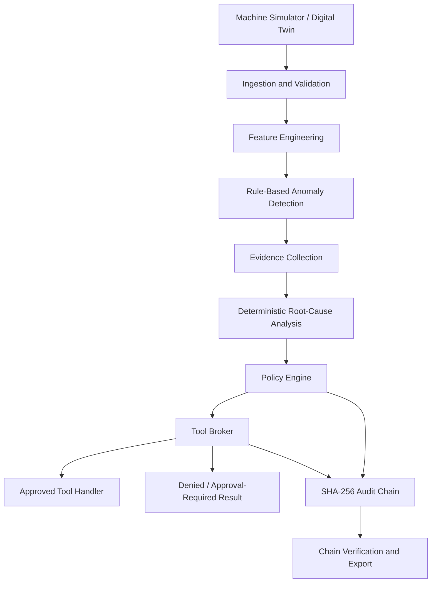

# FactoryMind

## Industrial AI for Machine Health Monitoring, Root-Cause Analysis, Governed Actions, and Auditable Operations

[](https://www.python.org/)
[](#testing-and-quality)
[](#architecture)
[](LICENSE)

**FactoryMind is an industrial AI engineering platform that simulates machine telemetry, identifies abnormal behavior, explains likely failure causes, evaluates operational policies, and routes permitted actions through a controlled tool broker with a tamper-evident audit trail.**

It is designed around a practical industrial principle: **detecting a problem is not the same as being authorized to act on it**. FactoryMind separates anomaly detection, root-cause analysis (RCA), safety-policy evaluation, action execution, and audit recording into explicit components.

> **Project scope:** The implementation uses a digital-twin-style simulator and synthetic telemetry. It is a reference implementation for industrial AI, predictive maintenance, reliability engineering, and governed-agent workflows. It is not connected to a real factory by default and is not a certified safety system.

---

## Contents

- [Why FactoryMind?](#why-factorymind)
- [What it does](#what-it-does)
- [Key capabilities](#key-capabilities)
- [Architecture](#architecture)
- [End-to-end workflow](#end-to-end-workflow)
- [Example output](#example-output)
- [Technology stack](#technology-stack)
- [Repository structure](#repository-structure)
- [Quick start](#quick-start)
- [Configuration](#configuration)
- [Testing and quality](#testing-and-quality)
- [Industrial use cases](#industrial-use-cases)
- [Security, safety, and reliability considerations](#security-safety-and-reliability-considerations)
- [Limitations](#limitations)
- [Roadmap](#roadmap)
- [License](#license)

## Why FactoryMind?

Industrial assets generate many signals—temperature, vibration, pressure, current, speed, load, cooling flow, and acoustic level. A single high reading may indicate a real fault, a transient spike, a drifting sensor, or a failed sensor. A useful monitoring workflow therefore needs more than a threshold alarm.

FactoryMind demonstrates a layered approach:

1. Simulate machine telemetry and failure progression.
2. Validate readings and detect missing, implausible, or contradictory values.
3. Calculate rolling statistics, temporal trends, and sensor-correlation features.
4. Detect anomalies using thresholds with optional trend confirmation.
5. Compare observed evidence with known failure signatures to produce an explainable root-cause result.
6. Evaluate whether a requested action is permitted and whether human approval is required.
7. Execute actions only through a single policy-enforcing broker.
8. Record actions and decisions in a SHA-256 hash-chained audit log.

The goal is to make the reasoning path inspectable and repeatable, rather than hiding operational decisions inside an opaque agent loop.

## What it does

| Stage | In plain language | Output |
|---|---|---|
| Digital twin | Generates plausible machine readings and simulated faults | Time-stamped telemetry snapshots |
| Ingestion and validation | Checks that sensor readings are present and plausible | Accepted snapshots and validation events |
| Feature engineering | Looks at recent history, trends, and relationships between sensors | Feature vectors and trend/correlation indicators |
| Anomaly detection | Checks thresholds and whether suspicious values persist or trend | Anomaly records |
| Root-cause analysis | Compares the evidence with known failure patterns | Ranked root-cause result with evidence and confidence score |
| Policy engine | Decides whether an action is allowed, denied, or needs approval | Policy decision |
| Tool broker | Validates the tool request and enforces the policy/approval path | Tool execution result or denial |
| Audit chain | Records the decision and action with linked hashes | Verifiable audit events |

## Key capabilities

### 1. Digital-twin-style machine simulation

The simulator models nine sensor channels:

- Temperature
- Vibration
- Pressure
- Motor current
- RPM
- Load
- Coolant temperature
- Coolant flow
- Acoustic level

The simulator can inject seven failure modes with different temporal signatures:

- Bearing degradation
- Bearing failure
- Thermal overload
- Cooling failure
- Mechanical imbalance
- Motor overload
- Sensor fault

It includes 11 predefined scenarios, including healthy operation, gradual degradation, sudden failure, sensor dropout, drift, and stuck readings. Sensor noise and quality issues can be simulated to test the pipeline under imperfect data.

**Why this matters:** Synthetic scenarios allow repeatable testing of rare failures without risking real equipment. They do not replace validation on real, labelled industrial data.

### 2. Data validation and feature engineering

The ingestion layer checks that expected sensor channels are present, values are within plausible ranges, missing/NaN readings are within configured limits, and readings do not contradict basic system relationships.

Feature engineering includes:

- Rolling mean, standard deviation, minimum, and maximum
- Exponentially weighted moving average (EWMA)
- Lag features
- Least-squares trend slopes
- Sensor-pair correlation deviation

For example, high vibration together with rising temperature may support a bearing-degradation hypothesis. An isolated vibration spike while related channels remain normal may instead support a sensor-fault hypothesis. These are evidence patterns, not guaranteed diagnoses.

### 3. Explainable anomaly detection

The rule-based detector compares sensor values against configurable warning and critical thresholds. Trend confirmation can help avoid raising an alarm for every isolated spike.

The documented anomaly categories include:

- `THRESHOLD_BREACH`
- `TREND_ANOMALY`
- `CORRELATION_ANOMALY`
- `CONTRADICTION`

The detector emits structured anomaly records instead of only printing a warning.

### 4. Deterministic root-cause analysis (RCA)

The RCA engine compares observed evidence against predefined failure signatures. Each signature describes primary and secondary sensors, expected trends, and relevant correlation pairs.

The documented fixed scoring weights are:

- Primary sensor match: `+0.30`
- Secondary sensor match: `+0.15`
- Trend match: `+0.10`
- Contradiction penalty: `-0.20`

The highest-scoring candidate is selected according to the implemented rules. Contradictory readings can help distinguish a sensor fault from a genuine machine fault.

> **Important:** These are rule-based confidence scores, not calibrated probabilities. They should not be interpreted as a statistically validated failure probability.

### 5. Policy-as-code and human approval

The policy engine evaluates requests using eight ordered rules. The documented policy behavior includes:

- Block actions when a machine is shut down or under maintenance.
- Allow read-only tools automatically.
- Allow inspection scheduling only when the configured degradation condition is met.
- Require operator approval for load reduction at a higher degradation level.
- Require supervisor approval for shutdown under severe/critical risk conditions.
- Deny by default when no rule grants permission.

The final decision is one of:

- `ALLOW`
- `DENY`
- `REQUIRE_APPROVAL`

This is a key industrial design feature: a detection or AI recommendation does not itself grant permission to operate machinery.

### 6. Controlled tool execution

The tool broker is the single path for tool execution. Its documented sequence is:

1. Confirm the requested tool exists.
2. Validate the input against the tool schema.
3. Evaluate policy.
4. Verify required approval.
5. Execute the handler only if permitted.
6. Write the audit event.

If a required step fails, execution is denied.

The six documented tools are:

- `get_machine_status`
- `get_sensor_history`
- `schedule_inspection`
- `reduce_machine_load`
- `shutdown_machine`
- `request_human_approval`

The read-only tools are designed for automatic approval; operational actions are subject to policy and approval requirements.

### 7. Tamper-evident audit chain

Every audit event can record the event type, timestamp, actor, tool, input/output, policy decision, previous hash, and event hash. Each event hash incorporates the previous event hash, linking the records into a chain.

A verification routine walks the chain and checks the links. If a stored event is modified without recomputing the subsequent chain correctly, verification can detect the inconsistency.

A hash chain is **tamper-evident**, not automatically tamper-proof: an actor with sufficient access could potentially rewrite an entire chain. Production use should add access controls, independent backups, key management where appropriate, and storage outside the process that generates the records.

## Architecture



### Design principles

- **Deterministic reasoning:** The documented RCA path uses fixed rules and weights; no LLM is in the reasoning loop.
- **Policy enforcement:** All operational tools pass through the broker.
- **Default deny:** A request is not executed merely because it was suggested.
- **Immutable domain models:** Frozen dataclasses reduce accidental mutation of core records.
- **Configuration as code:** Sensor ranges, thresholds, and policy settings are externalized in YAML.
- **Separation of concerns:** Simulation, features, detection, RCA, policy, tools, and audit each have clear responsibilities.

## End-to-end workflow

Consider a simulated machine with rising vibration and temperature.

1. The simulator produces a time-stamped snapshot containing nine sensor readings.
2. The ingestion pipeline validates the snapshot and adds it to the rolling history.
3. The feature layer calculates recent averages and trends.
4. The detector identifies threshold/trend anomalies.
5. The RCA engine compares the evidence against failure signatures.
6. The policy engine evaluates any proposed action against machine state, risk, permissions, and thresholds.
7. The tool broker either denies the action, requests approval, or executes the approved handler.
8. The audit chain records the decision and its execution outcome.

The pipeline keeps **evidence**, **diagnosis**, **authorization**, and **execution** distinct. This separation makes failures easier to debug and operational decisions easier to review.

## Example output

The examples below illustrate the shape of a possible result based on the documented concepts. They are **illustrative examples, not captured production output from a real machine**. Exact field names and serialization should be confirmed against the current implementation.

### Example 1 — Telemetry snapshot

```json
{
  "machine_id": "machine-0042",
  "timestamp": "2026-10-20T08:30:00Z",
  "sensors": {
    "temperature": 84.2,
    "vibration": 7.8,
    "pressure": 5.1,
    "motor_current": 18.6,
    "rpm": 1450,
    "load": 0.78,
    "coolant_temperature": 42.0,
    "coolant_flow": 12.5,
    "acoustic_level": 76.0
  }
}
```

**How to read it:** The snapshot records sensor values at one point in simulated time. Whether a value is abnormal depends on the configured ranges, history, trends, and machine context.

### Example 2 — Anomaly and root-cause explanation

```json
{
  "anomalies": [
    {
      "sensor": "vibration",
      "type": "THRESHOLD_BREACH",
      "severity": "warning",
      "trend": "increasing"
    },
    {
      "sensor": "temperature",
      "type": "TREND_ANOMALY",
      "severity": "warning",
      "trend": "increasing"
    }
  ],
  "root_cause": {
    "candidate": "BEARING_DEGRADATION",
    "confidence_score": 0.65,
    "supporting_evidence": [
      "primary sensor vibration is abnormal",
      "secondary sensor temperature is abnormal",
      "both signals show an increasing trend"
    ]
  }
}
```

**How to read it:** The engine presents a candidate failure mode and the evidence that supports it. The score is a rule-based score in this illustrative example—not a calibrated probability.

### Example 3 — Policy decision

```json
{
  "requested_tool": "reduce_machine_load",
  "decision": "REQUIRE_APPROVAL",
  "reason": "Load reduction requires operator approval and the configured degradation condition must be met",
  "execution_status": "NOT_EXECUTED"
}
```

**How to read it:** A tool request can be blocked from execution until the required approval is present. A request is not the same thing as a completed action.

### Example 4 — Audit event

```json
{
  "event_type": "TOOL_EXECUTION_DENIED",
  "actor": "factorymind-policy",
  "tool": "reduce_machine_load",
  "policy_decision": "REQUIRE_APPROVAL",
  "previous_hash": "<previous-event-sha256>",
  "event_hash": "<sha256-of-this-event-and-chain-link>"
}
```

**How to read it:** The event links to the previous record. The real implementation calculates the hashes; the placeholders above are not actual hashes.

## Technology stack

| Technology | Role in FactoryMind | Why it is useful |
|---|---|---|
| Python `>=3.11` | Core application and domain logic | Broad ecosystem for industrial data and automation |
| NumPy | Numeric operations and simulated sensor noise | Efficient numerical processing |
| Pandas | Dataset creation and tabular telemetry workflows | Convenient CSV/dataframe operations |
| SciPy | Statistical utilities | Supports signal/statistical analysis |
| scikit-learn | Feature/ML extension points | Can support future learned anomaly models |
| Pydantic / dataclasses | Validated and immutable domain records | Makes contracts explicit and easier to test |
| PyYAML | External configuration | Keeps thresholds and settings out of code |
| pytest / pytest-cov | Unit and integration tests | Regression protection and coverage reporting |
| Ruff | Linting and formatting | Consistent, maintainable Python |
| mypy | Static type checking | Finds type errors before runtime |
| PyTorch (optional) | Potential learned models | Extension point; not required for deterministic RCA |
| FastAPI (optional) | REST API extension | Potential integration boundary for other systems |
| FAISS (optional) | Vector search extension | Optional retrieval use cases; not part of the deterministic RCA loop |
| MLflow (optional) | Experiment tracking | Tracks model experiments if ML components are added |

The base project is designed to work without requiring an LLM for the core diagnostic and policy path. Optional packages should be installed only when their corresponding features are used.

## Repository structure

```text
.
├── pyproject.toml             # Package metadata and dependencies
├── Makefile.py                # Documented build/development command definitions
├── SETUP_GUIDE.md             # Local setup guide
├── PROJECT_STRUCTURE.md       # Detailed file-by-file architecture
├── configs/
│   └── default.yaml           # Sensor ranges, thresholds, policies, simulation settings
├── scripts/
│   └── generate_dataset       # Runs simulation and writes a CSV dataset
├── factorymind/
│   ├── domain/
│   │   ├── enums.py           # Machine, health, risk, event, and tool states
│   │   └── models.py          # Domain data models
│   ├── simulation/
│   │   ├── sensors.py         # Nine sensor generators and sensor-quality effects
│   │   ├── failures.py        # Seven failure-mode patterns
│   │   ├── machine.py         # Machine simulator and degradation state
│   │   └── scenarios.py       # Eleven predefined scenarios
│   ├── ingestion/
│   │   ├── validation.py      # Telemetry validation
│   │   └── pipeline.py        # Ingestion buffer and event callbacks
│   ├── features/
│   │   ├── rolling.py         # Rolling statistics and EWMA
│   │   ├── temporal.py        # Trend slopes
│   │   └── correlations.py    # Sensor relationship deviations
│   ├── detection/
│   │   └── rules.py           # Threshold and trend detector
│   ├── rca/
│   │   ├── signatures.py      # Expected sensor patterns by failure mode
│   │   ├── evidence.py        # Evidence collection
│   │   └── engine.py          # Deterministic candidate scoring
│   ├── policy/
│   │   ├── permissions.py    # Tool permissions
│   │   ├── rules.py           # Ordered safety/approval rules
│   │   └── engine.py          # Policy decision evaluator
│   ├── tools/
│   │   ├── schemas.py         # Tool definitions and input validation
│   │   ├── machine_tools.py   # Six tool handlers
│   │   ├── registry.py        # Tool registry
│   │   └── broker.py          # Single execution path
│   └── audit/
│       ├── events.py          # Audit event records
│       ├── chain.py           # Hash-chained ledger
│       └── verification.py    # Chain integrity checks
└── tests/
    ├── unit/
    └── integration/
```

## Quick start

The documented project workflow describes a Python 3.11+ project, a YAML configuration, and a Makefile-based workflow. Check the actual repository files before running commands, since the command wrapper is named `Makefile.py` in the supplied project summary.

### 1. Create a virtual environment

```bash
python3.11 -m venv .venv
source .venv/bin/activate
python -m pip install --upgrade pip
```

Windows PowerShell:

```powershell
.venv\Scripts\Activate.ps1
```

### 2. Install dependencies

```bash
pip install -e .
```

If the project defines optional dependency groups, inspect `pyproject.toml` and install only the extras needed for the feature you intend to run.

### 3. Run the test suite

The documented project workflow lists these commands:

```bash
make test
make test-cov
make lint
make format
make typecheck
```

**Important:** Because the supplied summary names the file `Makefile.py`, confirm whether a real `Makefile` or another task runner is present. If there is no Makefile, run the corresponding commands directly, for example:

```bash
pytest
ruff check .
ruff format --check .
mypy factorymind
```

Use the actual package paths and configuration in the repository as the source of truth.

### 4. Generate a dataset or run a demo

The project summary documents a dataset-generation script and an interactive demo target. Inspect the script's `--help` output and the project setup guide to confirm exact arguments:

```bash
python scripts/generate_dataset --help
```

The intended dataset output is a CSV time series generated by the simulator. It is synthetic data and should be labelled as such in any evaluation or report.

## Configuration

The documented default configuration includes:

- Simulation size: 100 machines and 1,000 time steps
- Nine sensor ranges
- Warning and critical thresholds
- Policy settings and approval conditions

The exact YAML schema and defaults live in `configs/default.yaml`. Keep environment-specific settings and safety thresholds in configuration, and version configuration changes alongside test results.

For an industrial deployment, avoid treating a generic default threshold as universally safe. Thresholds must be calibrated to the machine type, operating regime, sensor placement, sampling rate, and manufacturer guidance.

## Testing and quality

The supplied project documentation reports **86 tests, all passing**. The documented test suite covers:

| Test area | What it checks | Why it matters |
|---|---|---|
| Simulation | Sensor generation, fault injection, scenario behavior | Makes failure cases repeatable |
| Feature engineering | Rolling windows, trends, correlations | Guards against incorrect feature calculations |
| Detection | Thresholds, warning/critical levels, trend confirmation | Prevents regressions in alert behavior |
| RCA | Signature matching, score calculation, sensor-fault distinction | Keeps explanations consistent with evidence |
| Policy | Ordered rules, permissions, approval and denial paths | Verifies that restricted actions remain blocked |
| Tools/broker | Registry, schema validation, execution and denial paths | Tests the action boundary |
| Audit | Hash chaining, verification, tamper detection | Checks integrity of the event history |
| End-to-end | Simulation through audit | Confirms the components work together in a vertical slice |

Run the tests in your environment and use the actual test report for public claims. For a stronger release pipeline, add CI, coverage thresholds, dependency scanning, and integration tests against a real message broker or historian once those integrations exist.

## Industrial use cases

Potential applications and demonstrations include:

- **Predictive-maintenance prototypes:** Explore degradation patterns and alert logic.
- **Condition monitoring:** Aggregate temperature, vibration, current, and cooling signals.
- **Root-cause support:** Show why a failure mode was selected and which signals contributed.
- **Governed industrial agents:** Demonstrate that tool calls pass through policy and approval gates.
- **Auditability:** Create a verifiable record of proposed, approved, denied, and executed actions.
- **Synthetic-data testing:** Generate repeatable edge cases for fault detection and policy testing.

These are potential applications of the architecture. The current documented simulator does not establish accuracy or reliability on real industrial equipment.

## Security, safety, and reliability considerations

Before connecting this kind of system to production machinery:

1. **Keep the safety boundary independent.** Machine safety interlocks and emergency-stop systems must remain authoritative and independent of this application.
2. **Require least privilege.** Use separate roles for read-only diagnostics, operator actions, and supervisor-level actions.
3. **Authenticate every caller.** Add identity, authorization, secure transport, input limits, and rate limiting before exposing APIs.
4. **Make approvals explicit.** Record who approved an action, what they approved, and when.
5. **Protect audit storage.** Restrict write access, export records to independently controlled storage, and test recovery.
6. **Handle stale and missing telemetry.** Define maximum data age, clock synchronization, dropout handling, and fail-safe behavior.
7. **Validate thresholds and RCA.** Evaluate against labelled real telemetry and document false-positive/false-negative rates.
8. **Test failure conditions.** Cover service outages, corrupt data, repeated requests, partial writes, and process restarts.
9. **Use controlled rollout.** Start in offline replay or read-only shadow mode before considering any action integration.

A hash-chained audit log and a policy engine are useful controls, but they do not by themselves make the whole system secure or safety-certified.

## Limitations

- Telemetry and failure scenarios are simulated, not evidence from a deployed plant.
- Rule-based detection can miss failure patterns not encoded in thresholds or trend rules.
- RCA scores are fixed heuristic scores and are not calibrated probabilities.
- The policy engine enforces application-level rules, not physical machine safety.
- The audit chain detects many forms of modification but is not inherently immutable against an administrator who controls the full storage environment.
- Kafka, real historians, PLC/SCADA systems, CMMS platforms, and industrial identity systems are not documented as fully implemented integrations in this project summary.
- Optional API/ML/LLM-related packages are extension points, not proof that an LLM is used in the core diagnostic loop.

## Roadmap

- [ ] Add a replay adapter for real historian/SCADA exports while remaining read-only by default.
- [ ] Evaluate detection and RCA on labelled data; report precision, recall, false-alarm rate, and lead time.
- [ ] Add schema/versioned event contracts and a message-broker adapter.
- [ ] Add API authentication, authorization, idempotency keys, and rate limits if an API is introduced.
- [ ] Add independent audit export, retention policy, and access-control tests.
- [ ] Add CI for unit tests, type checks, linting, coverage, and dependency/security scans.
- [ ] Add operator-facing incident summaries and approval history without bypassing deterministic policy.
- [ ] Document deployment, rollback, monitoring, and incident-response procedures.

## License

The supplied project summary specifies the **MIT License**. Ensure the repository includes a matching `LICENSE` file and that third-party dependencies and any future datasets are used under their applicable terms.

---

## Engineering summary

FactoryMind demonstrates a clear industrial AI workflow:

**Telemetry → Features → Anomaly Detection → Explainable RCA → Policy Decision → Controlled Tool Execution → Audit Verification**

Its differentiator is not simply identifying an anomaly. It is the explicit separation between evidence, diagnosis, authorization, execution, and audit—an architecture worth discussing for industrial AI, reliability engineering, and governed automation roles.
